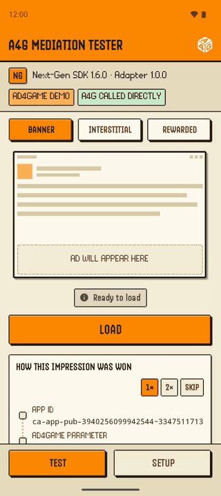
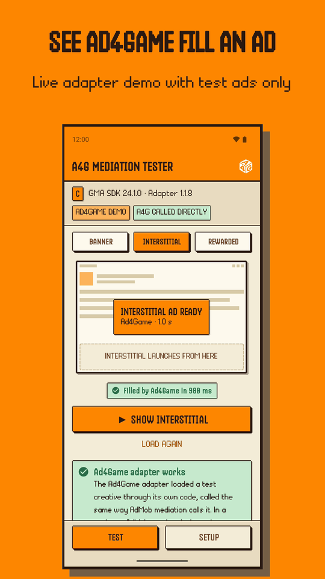
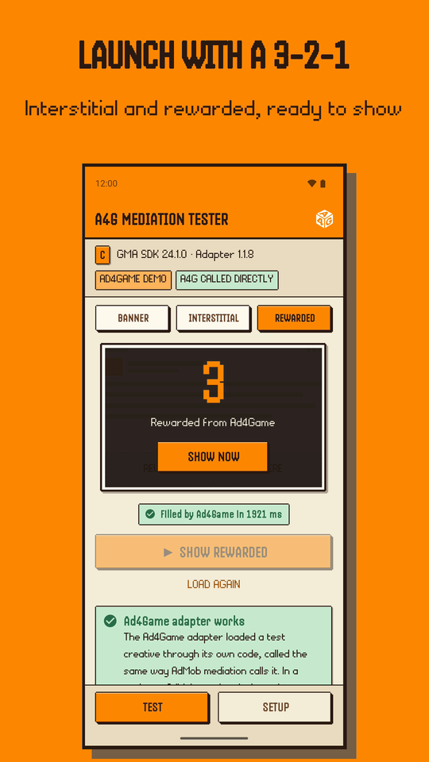
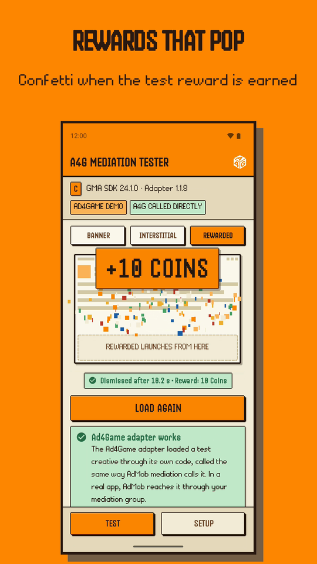
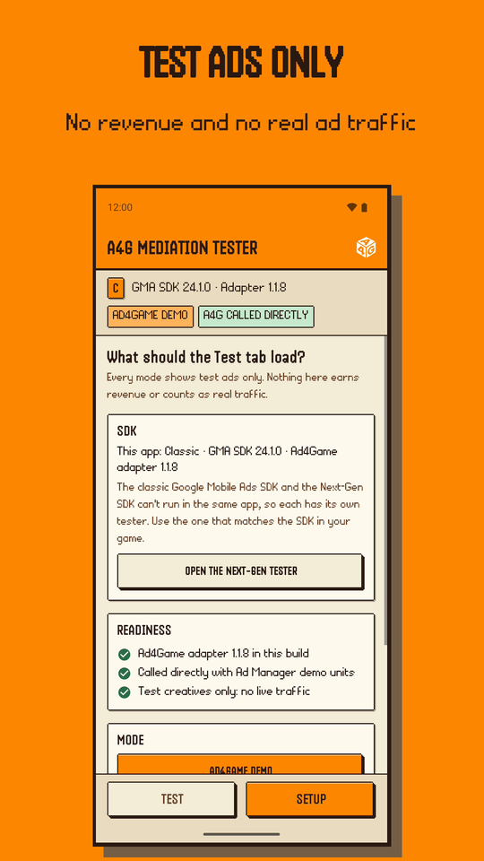

# A4G Mediation Tester

A developer tool from **Ad4Game** that shows the Ad4Game AdMob adapter working end to end, and explains, step by step, how an ad impression is won.

<a href="https://play.google.com/store/apps/details?id=com.hakim_ma.a4g">Get it on Google Play</a> · Classic SDK build

<p align="center">
  
</p>

<p align="center">
  
  
  
  
</p>

> **Test ads only.** Every ad in this app is a test ad. Nothing earns revenue or counts as real ad traffic, and rewards are test values with no real-world value.

## What it does

- **Ad4Game demo**: calls the Ad4Game adapter exactly the way AdMob mediation does (`AdmobCustomEventManager.load*Ad` with a `Mediation*AdConfiguration`), using Google Ad Manager demo units as the custom event Parameter. The adapter's real code path runs and fills with test creatives.
- **Google test units**: real AdMob mediation with Google's test ad units, to check that the SDK itself works. These never call Ad4Game.
- **"How this impression was won"**: an animated ladder built from the real `ResponseInfo`: App ID → ad unit → mediation group → every ad source the SDK actually called → winner, with real latencies. It is a replay of the real response (neither SDK streams events while loading), and it never shows prices.
- **Ad Stage**: banner, interstitial and rewarded, shown inside a device frame, with a 3-2-1 launch countdown and live impression and reward events.
- **Plain-language verdicts**: every load ends with a short explanation of what happened and what to check.

## Two builds, one codebase

The classic Google Mobile Ads SDK and the GMA Next-Gen SDK can't ship in the same app, so the project builds two installable apps from one codebase:

| Flavor | SDK | Ad4Game adapter | Package |
|---|---|---|---|
| `classic` | `play-services-ads` | `com.Ad4game:admobmanager` | `com.hakim_ma.a4g` (on Google Play) |
| `nextgen` | `ads-mobile-sdk` (Next-Gen) | `com.Ad4game:admobmanager-nextgen` | `com.ad4game.tester.nextgen` |

All UI lives in `app/src/main` and only talks to the `AdEngine` interface. Each flavor has its own small engine in `app/src/classic` or `app/src/nextgen`, so shared code never imports an SDK. Both flavors always build against the newest published Ad4Game adapter (`latest.release`).

## Build and run

Requirements: Android Studio (or a JDK 17+) and the Android SDK (compile/target SDK 36).

```bash
# Debug builds
./gradlew :app:assembleClassicDebug
./gradlew :app:assembleNextgenDebug

# Install and launch the classic tester
adb install -r app/build/outputs/apk/classic/debug/app-classic-debug.apk
adb shell am start -n com.hakim_ma.a4g/com.hakim_ma.a4g.MainActivity

# Unit tests (replay timing, verdict rules, ID validation)
./gradlew :app:testClassicDebugUnitTest
```

### Private values

This repository is public. Private values are read from the git-ignored `local.properties`, never from source:

```properties
# AdMob App ID for the classic flavor (falls back to Google's sample App ID if unset)
a4g.admobAppId=ca-app-pub-XXXXXXXXXXXXXXXX~NNNNNNNNNN

# Release signing (release builds are unsigned without these)
a4g.storeFile=/path/to/your.keystore
a4g.storePassword=...
a4g.keyAlias=...
a4g.keyPassword=...
```

`-Pa4g.admobAppId=...` on the command line overrides `local.properties`. The Next-Gen flavor always uses Google's sample App ID.

## Testing Ad4Game in your own app

This tester shows the adapter working. To check **your own** integration, use Google's **Ad Inspector** inside your app, on a test device:

1. Add the Ad4Game custom event to your AdMob mediation group, with the class name `com.ad4game.admobadapter.AdmobCustomEventManager` and the Parameter your Ad4Game account manager gave you.
2. Open Ad Inspector on a registered test device (see [Ad Inspector](https://developers.google.com/admob/android/ad-inspector)).
3. Under **Adapters**, check that the Ad4Game custom event is listed.
4. Use **Single ad source test** to send requests to Ad4Game only, and read the **SDK request log** to see the waterfall ([verify adapter integrations](https://developers.google.com/admob/android/ad-inspector/verify-adapter-integrations)).

Never click live ads on your own ad units: it counts as invalid traffic.

## Project layout

```
app/src/main/java/com/hakim_ma/a4g/
├── engine/      AdEngine contract and shared models (no SDK imports)
├── domain/      Verdict rules
├── data/        Saved settings, ID validation, test-device helpers
└── ui/          Ad Stage, waterfall replay, setup, pixel UI kit
app/src/classic/   Classic SDK engine + direct Ad4Game adapter driver
app/src/nextgen/   Next-Gen SDK engine + direct Ad4Game adapter driver
nextgen-testapp/   Minimal Next-Gen harness used for adapter and R8 checks
```

## Credits

- [Pixel AE](https://essssam.itch.io/pixel-ae) by Ahmed Essam, CC0 (body text)
- [Handjet](https://github.com/rosettatype/Handjet) by Rosetta, SIL Open Font License 1.1 (titles and buttons)

AdMob and Google Mobile Ads are trademarks of Google LLC. This project is not affiliated with or endorsed by Google.
